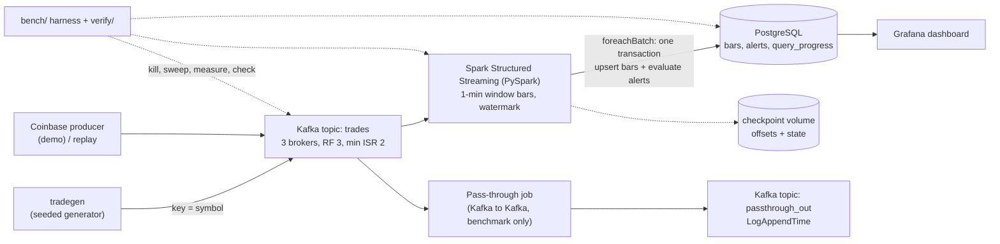

# Build Plan: Real-Time Market-Data Pipeline with Apache Kafka and Spark Structured Streaming

Group 6, COMPSCI 4411/9538. Authors: Arya Zarei, Rawad Alharastani, Mark Samwaiel.
Plan written 2026-11-06. Target: application feature-complete by **Sat 2026-11-21**, experiments done by **Sat 2026-11-28**, `v1.0` tagged by **Mon 2026-11-30**, course deadline Dec 1.

## 0. How to read this document

- **Authority order:** `docs/proposal/proposal.pdf` (the confirmed proposal) > this plan > `CLAUDE.md`. Where this plan adds detail the proposal does not give, the item is marked **[DECISION Dn]** and listed in section 13 so the group can confirm or change it.
- **Do not change** any value the proposal fixes without asking: 100 symbols, 1-minute bars (open, high, low, close, VWAP), alert = more than 3 standard deviations from the average over the previous 30 bars, 3 Kafka brokers, replication factor 3 with at least 2 in-sync replicas, one `docker compose up` to start everything, PySpark, PostgreSQL results store, Grafana dashboard, three runs per setting with median, p95 and p99 latency, one 16 GB machine.
- **Roles are ignored on purpose.** Work is split into tasks (section 9) that any member can pick up. Section 9 notes which tasks can run in parallel.
- Anything about a library's current API, image tag or option name must be checked against current documentation before use. Do not write it from memory.

## 1. Goal and scope

### 1.1 What the application is

A market-data pipeline that runs entirely in Docker Compose on one machine:

1. A **trade generator** (seeded, deterministic) publishes trades for 100 symbols to a 3-broker Kafka cluster, keyed by symbol.
2. A **Spark Structured Streaming job** (PySpark) computes 1-minute bars per symbol (open, high, low, close, volume, VWAP) and writes them to PostgreSQL.
3. In the same write step, the job evaluates the **alert rule** (section 5.5) and writes alerts to an `alerts` table.
4. A **Grafana dashboard** reads PostgreSQL and shows bars and alerts live.
5. A **verification harness** proves the output is correct (no lost, duplicated or wrong bars and alerts), and a **benchmark harness** scripts the crashes and sweeps that answer the three research questions.
6. For the demo, a **live producer** streams Coinbase public trades into the same pipeline, with a saved copy to replay if the connection fails.

### 1.2 What it is for

The app is the case study for three research questions in the proposal:

- **RQ1:** how partitions, Spark's batch trigger interval, and processing mode trade latency against throughput.
- **RQ2:** which Kafka settings prevent lost or duplicated data when a broker crashes, and how long Spark takes to recover after its own crash.
- **RQ3:** what exactly-once output costs compared with at-least-once output.

It also reproduces two published results (shape of the curve only, not absolute numbers): producer throughput without and with batching (Kreps et al., Figure 4) and latency versus input rate for a pass-through job in continuous mode against micro-batch maximum throughput (Armbrust et al., Figure 7). Re-read both figures and their setup text before implementing and record any deviation in `docs/decisions.md`.

### 1.3 Out of scope

Kafka security features (described in the report, not built or measured), multi-machine clusters, Kafka Streams, schema registry, production hardening, the report and slides themselves (the app only has to produce the results they need, see section 12).

## 2. Timeline

Today is Fri Nov 6. The proposal's windows were: Nov 3 to 14 Kafka, generator and Spark job; Nov 15 to 21 PostgreSQL, dashboard and measurement scripts; Nov 22 to 30 experiments. PostgreSQL is needed earlier than the proposal lists, because the Spark job writes to it, so it moves into M0.

| Milestone | Dates | Outcome | Gate |
|---|---|---|---|
| M0 Foundation | Nov 6 to 8 | Repo, pinned versions, full stack starts healthy with `docker compose up`, oracle ported to tests | **G0:** all containers healthy, topics exist, `make test` passes |
| M1 End-to-end bars | Nov 9 to 14 | Generator, Spark bars job, alerts, verifier v1 | **G1:** the golden dataset replayed through Kafka and Spark gives 100% matching bars and alerts in PostgreSQL |
| M2 Output and measurement | Nov 15 to 21 | Dashboard, Kafka-layer verification, pass-through job, latency collectors, benchmark harness, fault injection, Coinbase producer, clean-clone quickstart | **G2 (feature freeze, Nov 21):** every experiment has a working one-minute dry run |
| M3 Experiments | Nov 22 to 28 | All experiments run three times, results committed, plots | **G3:** `results/summary.csv` and figures committed |
| M4 Freeze | Nov 29 to 30 | Fresh-clone test on a second machine, docs, `v1.0` tag | **G4:** tag pushed |

Start the report, slides and demo script during M2. Waiting for experiments to finish leaves too little time.

## 3. Architecture



Key design facts the implementation must respect:

- Kafka orders events only within a partition. Keying by symbol keeps each symbol's trades ordered.
- Spark's Kafka source creates one Spark task per Kafka partition by default. Spark records the Kafka offsets of each batch and its state in its **own checkpoint**, not in Kafka consumer groups.
- A windowed aggregation in **append mode** emits a window only after the watermark passes the window end. That is when a bar becomes "finalizable", and it is the start point of the bar-latency measurement.
- Exactly-once output comes from replay (Kafka offsets in the checkpoint) plus an idempotent sink (upsert on `(symbol, window_start)`). Experiment 4 compares that with a plain insert.
- Continuous mode supports only simple per-record operations, so it cannot run the bars job. It runs the pass-through job.

## 4. Data requirements

### 4.1 Data sources

| Source | Used for | Notes |
|---|---|---|
| Synthetic generator (`tradegen`), seeded | All benchmarks, all correctness experiments, the demo bootstrap | Deterministic price paths, known shock times, unique trade IDs. Primary source. |
| Golden sample dataset in `data/sample/` | Unit and integration tests, replay, onboarding, the oracle | 40 virtual minutes, 100 symbols, 60,163 trades. Committed (about 1.1 MB). |
| Coinbase public WebSocket | Live demo only | No API key. Check Coinbase's current docs for endpoint, channel and message format. Not part of any benchmark. |
| Replay file captured from Coinbase | Demo fallback | Captured during development, committed only if small, otherwise attached to a GitHub release. |

No external dataset is required for the benchmarks. The proposal chose a synthetic generator so the correct answer is known exactly.

### 4.2 Trade record (one Kafka message)

- **Key:** the symbol as UTF-8 bytes.
- **Value:** JSON. **[DECISION D4: JSON, not Avro, for debuggability.]**

```json
{"trade_id": 1, "symbol": "SYM078", "event_time_ms": 1767623400023, "price": 81.3873, "size": 25}
```

| Field | Type | Meaning |
|---|---|---|
| `trade_id` | int64 | Unique within a run, assigned in `(event_time_ms, symbol)` order. For the live feed, assigned by the adapter's own counter. |
| `symbol` | string | `SYM001` to `SYM100` for synthetic data. Coinbase product ids for live data. |
| `event_time_ms` | int64 | Trade creation timestamp, epoch milliseconds. |
| `price` | double | Rounded to 4 decimals (avoids degenerate zero-variance baselines). |
| `size` | double | Positive. Integer-valued for synthetic data, fractional for crypto. |

The Kafka record timestamp is left to the producer default (wall-clock now). Event time lives only in the JSON value. This avoids old virtual timestamps interacting with time-based topic retention.

### 4.3 Generator requirements

The reference implementation is `tools/gen_sample_dataset.py`. The real generator must reproduce its model.

| Item | Requirement |
|---|---|
| Symbols | 100. Per-symbol arrival rates follow a skew where the busiest symbol is about 10 times the quietest (`symbols.csv` lists each rate). Mean 0.25 trades per second per symbol in the golden set. |
| Prices | Log-price random walk. Per-symbol start price (clipped 10 to 800) and 1-minute volatility (0.05% to 0.12%). |
| Sizes | Log-normal around 100, integer, clipped 1 to 10,000. |
| Shocks | Known permanent log-price jumps of 1.5% to 3% (either sign) at known times, injected only after a symbol has a full 30-bar baseline. Listed in `shocks.json`. |
| Seeds | One `SeedSequence(seed)`, with an independent child stream per symbol so changing the symbol count does not shift other symbols' paths. |
| Determinism | Same seed and same pinned numpy version give the same trades. A test compares output with `data/sample/MANIFEST.json`. |
| Flush | After the last trade, the generator sends one trade with the reserved symbol `__FLUSH__` and an event time two minutes later, so the watermark closes all real windows. Verification ignores that symbol. |

**Modes**

| Mode | Event time | Pacing | Use |
|---|---|---|---|
| `realtime` | Wall clock at creation | Target trades per second (`--rate`) | Latency and throughput experiments (E1) |
| `virtual` | Deterministic virtual clock starting at a fixed time | `--speed S` virtual seconds per wall second, or `max` (unpaced) | Demo bootstrap, correctness experiments (E2 to E4), golden runs |
| `replay` | From a file (CSV or captured JSON lines) | `--speed S` or `max` | Golden dataset, Coinbase capture fallback |
| `live-coinbase` | Exchange time mapped to ms | Real time | Demo |

Why `virtual` exists: the alert rule needs 30 prior bars, so with real-time bars the first alert appears only after about 32 minutes. At speed 30, 40 virtual minutes pass in about 80 seconds, so the demo shows alerts quickly. Virtual mode also makes every correctness run fully deterministic, so the expected bars and alerts can be computed offline before the run.

**Producer settings (configurable by flag, recorded in every run log):** `acks` (1 or all), `enable.idempotence`, `linger.ms`, `batch.size`, `retries`. Default for the pipeline: `acks=all`. Every send registers a delivery callback, and the generator logs each trade's ack outcome. That log is the ground truth for loss detection (section 5.8).

**CLI sketch** (final names are the implementer's choice, but keep these capabilities):

```
tradegen --mode realtime --rate 5000 --duration 300 --acks all --run-id r001 --log-trades
tradegen --mode virtual --speed 30 --minutes 40 --seed 42
tradegen --mode replay --file data/sample/trades.csv.gz --speed max
tradegen --mode live-coinbase --products BTC-USD,ETH-USD --save runs/live_capture.jsonl
```

At high rates one Python process may not saturate the pipeline. If so, run several generator processes over disjoint symbol sets. Spike S4 settles this.

### 4.4 Golden sample dataset (`data/sample/`)

Shipped with this plan and generated by `python tools/gen_sample_dataset.py --out data/sample`.

| File | Contents |
|---|---|
| `trades.csv.gz` | 60,163 trades: `trade_id,symbol,event_time_ms,price,size`. Start 2026-01-05T14:30:00Z, 40 virtual minutes. |
| `bars_expected.csv` | 4,000 expected 1-minute bars (100 symbols by 40 minutes). |
| `alerts_expected.csv` | 23 expected alerts under the rule in section 5.5. |
| `shocks.json` | The 20 injected shocks. All 20 are detected by the rule. 3 further alerts are ordinary statistical exceedances. |
| `symbols.csv` | Per-symbol start price, volatility and arrival rate. |
| `MANIFEST.json` | Parameters, row counts, SHA-256 of each file's uncompressed content, numpy and pandas versions. |

The expected-alert logic in the oracle was cross-checked against an independent plain-Python implementation: the 23 alerts are identical.

How to use it:

- **Unit tests:** the oracle's bars and alerts must equal the expected files, and the Spark job's output must equal them too.
- **Golden run (gate G1):** replay `trades.csv.gz` unpaced into Kafka, run the Spark job, run the verifier, expect zero differences.
- **Parallel development:** the Spark developer works against replayed sample data while the generator developer builds `tradegen`. Neither waits for the other.

Alerts only exist after 31 changes, so any alert test needs at least 32 bars per symbol. The sample has 40.

### 4.5 Data handling rules

- Commit the golden sample (small). Do not commit run outputs: they go to `runs/` and `results/raw/`, both git-ignored.
- GitHub rejects files over 100 MB. Anything over about 5 MB goes in a release asset with a download script.
- The repo is public (the proposal says so). No secrets, no course handouts, no rubric files.
- Each run writes `runs/<run_id>/config.json` (all parameters, versions, git commit, machine specs) so any result can be traced and reproduced.

## 5. Component requirements

IDs are stable so tasks and issues can refer to them.

### 5.1 Compose and infrastructure (INF)

| ID | Requirement |
|---|---|
| INF-1 | `docker compose up --build` from a clean clone starts everything and shows a populated dashboard with no other manual step. |
| INF-2 | Services: `kafka-1`, `kafka-2`, `kafka-3` (KRaft, no ZooKeeper), `kafka-init` (creates topics, exits), `postgres`, `spark-bars` (driver, `local[4]`), `grafana`, `generator` (default: virtual mode, speed 30). Compose **profiles** for optional services: `bench` (pass-through job), `live` (Coinbase producer). **[DECISION D2: Spark in `local[4]` inside one container with a 4-CPU limit, matching the 4-core setup in the Armbrust experiment and saving memory. A standalone cluster is not needed because the proposal drops executor sweeps.]** |
| INF-3 | Every image pinned to an exact tag in `.env` (see section 7). Python dependencies pinned in lock files. |
| INF-4 | Health checks on every service, and `depends_on: condition: service_healthy` so startup order is correct. |
| INF-5 | Named volumes for Kafka data, PostgreSQL data and the Spark checkpoint. The checkpoint must survive container kills, because Experiments 3 and 4 depend on that. |
| INF-6 | Kafka broker settings: `default.replication.factor=3`, `min.insync.replicas=2`, `offsets.topic.replication.factor=3`, `transaction.state.log.replication.factor=3`, `transaction.state.log.min.isr=2`, `unclean.leader.election.enable=false`. Heap capped (about 1 GB per broker). |
| INF-7 | Makefile targets: `up`, `down`, `reset` (remove volumes), `logs`, `test`, `verify`, `demo`, `bench-<name>`, `bench-all`. |
| INF-8 | Memory budget fits a 16 GB machine with Docker given about 10 to 12 GB (section 7.2). Provide a `docker-compose.lite.yml` override with smaller heaps for teammates with less RAM. |

### 5.2 Kafka topics (KAF)

| Topic | Partitions | RF | min ISR | Notes |
|---|---|---|---|---|
| `trades` | 6 by default; the harness recreates it with 1, 3 or 6 for sweeps | 3 | 2 | Key = symbol. Retention long enough for replays (for example 1 day). |
| `passthrough_out` | Same as the input topic, and at most 4 for continuous mode (see risk R4) | 3 | 2 | `message.timestamp.type=LogAppendTime` so latency uses the timestamp Kafka assigns on write. |
| `perf_test` | 1 | 1 | 1 | Only for reproduction (a), run with Kafka's own `kafka-producer-perf-test`. |

`kafka-init` must be idempotent (safe to run twice). The harness must wipe the Spark checkpoint whenever it recreates a topic, otherwise Spark fails on offsets that no longer exist (`failOnDataLoss`).

### 5.3 Generator (GEN)

See section 4.3. Additional requirements:

| ID | Requirement |
|---|---|
| GEN-1 | Virtual unpaced output for seed 42, 40 minutes equals `data/sample/trades.csv.gz` (golden test). |
| GEN-2 | Per-trade ack log (`trade_id`, acked or failed, partition, offset if acked) written asynchronously in batches, enabled by `--log-trades`, so logging does not distort throughput runs. |
| GEN-3 | Backpressure handling: when the producer queue is full the generator slows down and records that it did, instead of crashing or silently dropping. |
| GEN-4 | Final summary on exit: trades attempted, acked, failed, achieved rate. |
| GEN-5 | A `--shock-rate-per-min` option for the continuing demo (shocks keep occurring after the 30-bar warm-up). |

### 5.4 Spark bars job (SPK)

| ID | Requirement |
|---|---|
| SPK-1 | Read `trades` with the Kafka source, `startingOffsets` configurable, `maxOffsetsPerTrigger` configurable, `failOnDataLoss=true`. |
| SPK-2 | Parse JSON with an explicit schema. Event time column built with `timestamp_millis(event_time_ms)`. Drop the `__FLUSH__` symbol only after it has advanced the watermark (it must reach the aggregation, or filter after). |
| SPK-3 | `withWatermark` on event time. **[DECISION D6: 10 seconds.]** Document the trade-off in the report (shorter means lower latency and more dropped late data). |
| SPK-4 | 1-minute tumbling window per symbol, aligned to the epoch minute. open = price of the earliest trade, close = price of the latest trade, ordering by `(event_time_ms, trade_id)` so ties are deterministic (`min_by`/`max_by` on a struct is the usual way). high, low, volume (sum of size), trade_count, VWAP = sum(price x size) / sum(size). |
| SPK-5 | **Append output mode** with `foreachBatch` (so each bar is emitted once, when it is final). |
| SPK-6 | Trigger configurable: `processingTime` interval (100 ms, 500 ms, 1 s, 5 s). Default 1 s. |
| SPK-7 | Checkpoint on the named volume. |
| SPK-8 | `StreamingQueryListener` writes each progress event to `query_progress` (batch id, timestamp, input rows, input and processed rows per second, batch duration, per-partition latest versus processed offsets, total lag). Used by the dashboard and by the sustained-throughput test. |
| SPK-9 | Spark 4 enables ANSI SQL mode by default, so arithmetic errors (such as division by zero) raise instead of returning null. Use `try_divide` or equivalent where a zero denominator is possible. |
| SPK-10 | Fault hook for Experiment 4: environment variable `FAULT_AFTER_BATCH=N` makes the process kill itself with SIGKILL **after** batch N's database transaction commits and **before** the batch returns to Spark. That is exactly the window where a plain insert creates duplicates on replay. Off by default. |
| SPK-11 | Sink mode flag `SINK_MODE=upsert` (default) or `insert` (Experiment 4 baseline). |
| SPK-12 | Image has the Kafka connector jars baked in at build time, so `docker compose up` does not download packages at runtime. |

### 5.5 Alert rule and PostgreSQL sink (SNK)

**Alert rule (oracle definition). [DECISION D1: the proposal says "price change more than three standard deviations from that symbol's average over the previous 30 bars". This plan reads "price change" as the bar-to-bar log return of the close.]**

For each symbol, over its *existing* bars in time order:

```
change_t   = ln(close_t / close_{t-1})
mean_t     = mean(change_{t-30} .. change_{t-1})           # previous 30 changes
std_t      = sample std, ddof = 1, of the same 30 changes
alert_t    = std_t > 0  and  |change_t - mean_t| > 3 * std_t
z_t        = (change_t - mean_t) / std_t
```

- A symbol's first possible alert is its 32nd bar. Bars missing because a symbol had no trades in a minute are simply absent. "Previous 30 bars" means the previous 30 existing bars.
- A shock inside bar k moves close_k (or close_k+1 if no trade follows the shock inside bar k), so exactly one bar is flagged. For about 30 bars afterwards the shock inflates the baseline std. That is expected behaviour and worth a sentence in the report.
- Under normal noise about 0.3% to 1% of eligible bars still exceed 3 sigma, so a few "unexplained" alerts are normal (3 in the golden set).

**Write step (one PostgreSQL transaction per micro-batch):**

1. Upsert the batch's bars into `bars` keyed by `(symbol, window_start)`. The bars of a batch are small (at most about 100 symbols per closed minute), so collecting them in the driver and writing with `psycopg` is fine.
2. Evaluate the alert rule for those bars against the symbol's previous 30 bars (read from `bars`, which already contains the batch) and upsert into `alerts` keyed by `(symbol, window_start)`.
3. Commit. Record `written_at` as `clock_timestamp()` on first insert only. The update path must not change it, so the latency measurement stays valid after a replay.

Insert-or-update on `(symbol, minute)` is the idempotent write the proposal compares against plain insert. With `SINK_MODE=insert`, rows go to `bars_plain` and `alerts_plain` (no unique key), so replays create visible duplicates.

DDL is in Appendix A.

### 5.6 Pass-through job (PTJ)

| ID | Requirement |
|---|---|
| PTJ-1 | Read `trades`, write the same key and value to `passthrough_out`, no parsing and no aggregation. |
| PTJ-2 | Trigger switchable by flag: micro-batch (`processingTime`) or continuous (`continuous` with a checkpoint interval). |
| PTJ-3 | Continuous mode needs at least as many free cores as Kafka partitions or the query never makes progress. Cap partitions for continuous runs accordingly (risk R4, spike S3). |
| PTJ-4 | Runs under the `bench` profile only, never together with the bars job when measuring (they would share the same 4 cores). |

### 5.7 Dashboard (DSH)

Grafana provisioned from files committed to the repo (datasource and dashboard JSON), so a fresh `docker compose up` already has the dashboard. Check the current PostgreSQL datasource plugin type for the pinned Grafana version.

| ID | Panel |
|---|---|
| DSH-1 | Candlestick and VWAP for a selected symbol (dashboard variable `$symbol`). |
| DSH-2 | Latest bars table (all symbols, last few minutes). |
| DSH-3 | Alerts table (newest first) with symbol, window, log return and z-score. |
| DSH-4 | Alert count per minute. |
| DSH-5 | Pipeline health: input and processed rows per second, batch duration, lag (from `query_progress`), seconds since the newest bar was written. |
| DSH-6 | Auto-refresh 2 to 5 seconds. |

Time-axis note: in virtual mode, bar timestamps are in the virtual timeline (January 2026 in the golden data). Panels must use the data's own time range (or a "last N bars" query), not "last 5 minutes of wall clock", or they will look empty.

### 5.8 Verification (VER)

The verifier answers "is the output correct", independent of how fast it was. It exits non-zero on any failure and writes a JSON report.

| ID | Check |
|---|---|
| VER-1 (Kafka layer) | Compare trade IDs the producer logged as **acked** against what is actually in the topic (consume from the beginning). Reports `lost` (acked but absent) and `duplicated` (present more than once). This is the measurement for Experiment 2. |
| VER-2 (bars) | Compare PostgreSQL `bars` against expected bars. Report missing windows, extra windows, duplicate rows (in `bars_plain`), and value mismatches. Tolerances: OHLC and volume exact, VWAP absolute error at most 1e-6. Compute expected bars two ways and report both: (a) from the generator's own trade list, (b) from the topic's actual contents. (a) catches loss anywhere, (b) isolates Spark and sink errors from Kafka-layer loss. |
| VER-3 (alerts) | Alert set from PostgreSQL must equal the alert set the oracle computes from the expected bars (exact match on key, z-score within 1e-6, skip alerts whose `abs(z) - 3` is under 1e-9). |
| VER-4 (shocks, informational) | Fraction of injected shocks that produced an alert (expected 100% for the golden data). |
| VER-5 | Ignore `__FLUSH__` and any windows that had not closed when the run ended. |

The oracle lives in `verify/reference.py`, starting as a copy of the functions in `tools/gen_sample_dataset.py`. If either changes, the other changes in the same pull request.

### 5.9 Benchmark harness (BEN)

One command per experiment, driven by a YAML config, writing everything under `results/raw/<experiment>/<run_id>/`. Runs on the host (Python venv) and drives `docker compose`, `docker kill` and the Kafka CLI tools inside the broker containers.

General rules:

- Every setting runs **three times**. Report the median, 95th and 99th percentile latency (proposal).
- Pick **one** machine for all benchmark runs. Record its specs. Close other heavy apps. Do not run two experiments at once.
- Each run starts from a known state: stop the stack, remove topics and checkpoint, start, wait for healthy, run, stop, collect.
- Run order of importance if time runs short: E2, E3, E4 first (RQ2 and RQ3, the extension beyond the papers), then E1 reproductions, then the wider E1 sweeps.

**Latency definitions (proposal):**

- *Pass-through:* time from the trade's creation timestamp (`event_time_ms` in realtime mode) to the timestamp Kafka assigns when the output record is written (`LogAppendTime`). Collector: a consumer on `passthrough_out` that computes the difference per record and streams it to a file.
- *Bars:* time from when the bar can be finalized (window end plus the watermark delay) to when its row first appears in PostgreSQL (`written_at`).
- Everything runs on one machine and shares one clock.
- Latency is only meaningful in `realtime` mode.

**Sustained throughput:** the highest input rate at which Spark keeps up with Kafka over a **five-minute** run, meaning the gap between the newest offset and the offset Spark has processed does not grow. **[DECISION D5: operationalize "does not grow" as: the lag at the end of minute 5 is at most the largest lag seen in the first minute, and the least-squares slope of lag over minutes 2 to 5 is below 1% of the input rate per second.]** Find the rate by stepping up a ladder of rates (for example 1k, 2.5k, 5k, 10k, 20k, 40k trades per second, adapted to what the machine can do) and bisecting once.

| Exp | Question | What changes | What is measured | Procedure notes |
|---|---|---|---|---|
| **E1a** Reproduction (a) | Does batching raise producer throughput, as in Kreps Fig. 4? | Producer batching: disabled (`batch.size=0`, `linger.ms=0`) versus several batch sizes with a `linger.ms` long enough to fill them. Paper batches are counted in messages and the Java producer's batch size is in bytes, so approximate and document it. | Records per second and MB per second | Use `kafka-producer-perf-test` against `perf_test` (1 partition, RF 1), message size as in the paper. |
| **E1b** Reproduction (b) | Latency versus input rate in continuous mode, against micro-batch maximum throughput (Armbrust Fig. 7) | Input rate. Mode: continuous versus micro-batch. | Latency percentiles per rate (continuous) and sustained throughput (micro-batch) | Pass-through job. Partitions at most the core count. |
| **E1c** Pipeline performance | How do partitions and batch interval trade latency against throughput on the real pipeline? | Partitions 1, 3, 6; trigger 100 ms, 500 ms, 1 s, 5 s; input rate ladder | Sustained throughput, bar latency p50/p95/p99, lag | Do not run the full 12-cell grid blindly. Sweep partitions at the default trigger and triggers at the default partition count first (6 cells), then fill in if time allows. |
| **E2** Broker crash | Which producer settings prevent loss or duplicates when a broker dies? | `acks=1` versus `acks=all` (RF 3, min ISR 2). Kill the broker that leads partition 0 of `trades` with `docker kill` (SIGKILL) at 40 to 60% of the run. | Time writes are stalled (longest gap between acks), lost trades, duplicated trades (VER-1), bar correctness (VER-2) | `virtual` mode with a long enough run (at least 3 minutes, at least 60,000 trades). With `acks=1` a loss only happens if the killed leader had acked records not yet replicated, which may not happen on every kill. Repeat enough kills to estimate a loss rate, and report honestly if it is zero. Stretch: idempotence on versus off. |
| **E3** Spark crash | How long does Spark take to recover and is the output still correct? | Kill the Spark container mid-run with `docker kill`, then restart it with the same checkpoint | Recovery time (kill to first new batch committed, and to first new bar written), correctness (VER-2, VER-3) | Use `upsert` mode. Run once in live mode for realistic timing. Run once in **deterministic replay** mode (below) for exactly reproducible results. |
| **E4** Exactly-once cost | What does idempotent output cost, and what does a plain insert do after a crash? | `SINK_MODE=insert` versus `upsert`. Crash with `FAULT_AFTER_BATCH=N` (SPK-10) | Duplicate rows (`bars_plain` versus `bars`), throughput and bar latency with no crash for both modes | Duplicates are expected for `insert` and zero for `upsert`. Cost is measured on crash-free runs at the same input rate. |

**Deterministic replay mode (for exactly reproducible correctness runs):** preload the `trades` topic completely (virtual, unpaced), then start Spark from `earliest` with a fixed `maxOffsetsPerTrigger`. Batch boundaries then depend only on offsets, so the same batch crashes every time and duplicate counts repeat exactly. This delivers the proposal's promise that "crashes are scripted, so reruns give the same correctness results".

**Estimated machine time (planning numbers only):** about 20 minutes per rate ladder step set per configuration (4 steps of 5 minutes), times 3 repeats, is about 1 hour per configuration. The reduced E1c grid (6 configurations) is roughly 6 hours, E1a and E1b about 2 hours, E2 to E4 about 3 hours. Plan for 12 to 14 hours of unattended machine time, so run `make bench-all` overnight and make the harness **resumable** (skip runs whose result file already exists).

Outputs: `results/raw/` (git-ignored), `results/summary.csv` (committed; one row per setting with medians and percentiles), `results/figures/*.png` (committed), `results/MACHINE.md` (specs and versions).

### 5.10 Live producer and replay (LIVE)

| ID | Requirement |
|---|---|
| LIVE-1 | Connect to Coinbase's public market-trades WebSocket (no key), map messages to the trade record in section 4.2, send to `trades`. Read the current Coinbase docs to pick the endpoint and channel. |
| LIVE-2 | Reconnect with backoff. |
| LIVE-3 | Write every received trade to a capture file (JSON lines). |
| LIVE-4 | If the connection fails and does not recover within a set time, or if started with `--offline`, switch to replaying the latest capture. |
| LIVE-5 | A handful of products (10 to 20) is enough. The 100-symbol requirement applies to the synthetic generator. |
| LIVE-6 | Live data is never used in any benchmark. |

## 6. Repository layout

```
kafka-spark-pipeline/
  README.md            quickstart (written during M0, finished in M4)
  PLAN.md              this file
  CLAUDE.md            instructions for Claude Code sessions
  Makefile  docker-compose.yml  docker-compose.lite.yml  .env.example  .gitignore
  docs/
    proposal/proposal.pdf      the confirmed proposal (do not edit)
    decisions.md               every decision and deviation, with date and reason
    architecture.md            diagram and notes for the report
    runbook.md                 how to run each experiment, how to recover a broken stack
  infra/
    kafka/                     topic creation script and per-topic configs
    postgres/init.sql          schema (Appendix A)
    grafana/provisioning/      datasource and dashboard provider
    grafana/dashboards/        dashboard JSON
    spark/Dockerfile           Spark image with connector jars and psycopg
    generator/Dockerfile
  generator/                   tradegen package (modes, producers, live adapter)
  spark/                       bars_job.py, passthrough_job.py, common.py, listener
  verify/                      reference.py (oracle), verify.py
  bench/                       runner, experiment YAMLs, collectors, plotting
  tools/gen_sample_dataset.py  reference generator (oracle source)
  data/sample/                 golden dataset + MANIFEST.json
  results/                     summary.csv, figures/, MACHINE.md (raw/ is ignored)
  tests/                       unit and integration tests
```

## 7. Technology and versions

### 7.1 Stack (from the proposal; **pin exact patch versions**)

| Component | Proposal version | Notes |
|---|---|---|
| Apache Kafka | 4.4, 3 brokers, KRaft | Use the official `apache/kafka` image. The 3-node KRaft setup needs a shared cluster id and a quorum voter list. Check the 4.x docs for current setting names. |
| Apache Spark | 4.2, PySpark | Use the official Spark image or build from it. The Kafka connector artifact must match Spark's Scala version. |
| PostgreSQL | 18 | |
| Grafana | 13 | |
| Python | one version for generator, harness, verifier (3.12 or newer) | Lock files: `uv`/`pip-tools` or equivalent. |
| Docker Compose | v2 | |

Spike S1 (first task): confirm every one of these tags exists. If a version does not exist or is incompatible, pick the nearest released one, log it in `docs/decisions.md`, and tell the group because the proposal names these versions.

### 7.2 Memory budget on a 16 GB machine (planning estimate, verify in S1)

| Service | Approx. |
|---|---|
| 3 Kafka brokers (1 GB heap each plus overhead) | 4.5 GB |
| Spark driver and tasks (`local[4]`) | 3 GB |
| PostgreSQL | 0.5 GB |
| Grafana | 0.3 GB |
| Generator and collectors | 1 GB |
| Total | about 9.5 GB |

Docker Desktop must be given about 10 to 12 GB for this. The rest is for the OS and editor.

## 8. Starting the foundation

### 8.1 Create the repository (one person, about 15 minutes)

```bash
# 1. unpack the starter kit and enter it
unzip kafka-spark-pipeline-starter.zip && cd kafka-spark-pipeline-starter

# 2. create the GitHub repo and push (public, as the proposal states)
git init -b main
gh repo create <your-user-or-org>/kafka-spark-pipeline --public --source=. --remote=origin
git add . && git commit -m "Initial commit: plan, proposal, golden sample dataset"
git push -u origin main

# 3. add teammates
gh api -X PUT repos/<owner>/kafka-spark-pipeline/collaborators/<their-github-username> -f permission=push
```

Then in the repo settings: protect `main` (require a pull request, one approval). Three people on one repo is much calmer with short-lived branches and small pull requests.

### 8.2 Start Claude Code

Run Claude Code **on a machine that has Docker with about 10 to 12 GB allocated**, in the repo root. It reads `CLAUDE.md` automatically. Paste the kickoff prompt below as the first message.

### 8.3 Kickoff prompt (copy as is)

```
Read PLAN.md and CLAUDE.md fully, then docs/proposal/proposal.pdf. The proposal is the authority.

Do Milestone M0 only (PLAN.md section 9, tasks T00 to T05). Work in this order and stop after each numbered step to show me what you did:

1. Run spike S1: verify that the versions named in the proposal (Kafka 4.4, Spark 4.2, PostgreSQL 18, Grafana 13) exist as official Docker image tags. Read current documentation, do not rely on memory. Pin exact tags in .env.example and record the result in docs/decisions.md. If any version is missing, propose the nearest alternative and wait for my answer.
2. Write docker-compose.yml for a 3-broker KRaft Kafka cluster (RF 3, min ISR 2, per PLAN.md INF-6), kafka-init creating the topics in section 5.2, PostgreSQL with infra/postgres/init.sql from Appendix A, and Grafana with a provisioned PostgreSQL datasource. Add health checks. Add Makefile targets up, down, reset, logs. Show me `docker compose ps` with everything healthy.
3. Run spike S2: build the Spark image with the Kafka connector baked in and prove a tiny PySpark job reads from the trades topic.
4. Port the oracle: create verify/reference.py from tools/gen_sample_dataset.py and write tests proving that the bars and alerts computed from data/sample/trades.csv.gz equal bars_expected.csv and alerts_expected.csv. Run `python tools/gen_sample_dataset.py --out data/sample --check` and show it matches.
5. Set up CI (GitHub Actions): ruff, docker compose config validation, and the unit tests.
6. Open GitHub issues for every task in PLAN.md section 9, with the milestone, acceptance criteria and dependencies. Do not start M1.

Rules: small commits, work on a branch and open a PR, do not change any parameter the proposal fixes, and tell me whenever you deviate from PLAN.md.
```

## 9. Work breakdown

Checklist for GitHub issues. "||" means tasks that can run in parallel once their dependency is done. All acceptance criteria must be demonstrated, not claimed.

### M0 Foundation (Nov 6 to 8)

- [ ] **T00** Repo, branch protection, CI (ruff, compose config, tests), README stub. *Done when:* a PR runs CI green.
- [ ] **T01** Spike S1: confirm and pin versions (section 7.1). *Done when:* `.env.example` pins exact tags and `docs/decisions.md` records them.
- [ ] **T02** Compose: 3-broker KRaft cluster plus `kafka-init`. *Done when:* `docker compose up kafka-1 kafka-2 kafka-3 kafka-init` ends with healthy brokers and the section 5.2 topics, shown by `kafka-topics --describe` (RF 3, min ISR 2).
- [ ] **T03** Compose: PostgreSQL with schema, Grafana with provisioned datasource, health checks. *Done when:* Grafana's data source test passes against PostgreSQL.
- [ ] **T04** Spike S2: Spark image with connector jars, minimal job reads `trades`. *Done when:* a message published with `kafka-console-producer` appears in Spark's output.
- [ ] **T05** Port the oracle and tests. *Done when:* tests prove oracle output equals `data/sample/*_expected.csv`, and `--check` prints `MATCH`.
- **Gate G0:** `docker compose up` brings everything healthy, `make test` passes.

### M1 End-to-end bars (Nov 9 to 14)

After T05, these three streams are independent because the golden dataset and the oracle define the contract:

- [ ] **T10** (stream 1) `tradegen` core: realtime, virtual, replay, unpaced; seeded; ack log; golden test GEN-1. *Done when:* `tradegen --mode virtual --speed max --seed 42 --minutes 40` equals `trades.csv.gz`, and trades appear in Kafka keyed by symbol.
- [ ] **T11** (stream 2) Spark bars job: SPK-1 to SPK-7, SPK-9, SPK-11, writing `bars` with upsert. *Done when:* replaying the sample gives all 4,000 bars in PostgreSQL matching `bars_expected.csv`.
- [ ] **T12** (stream 2) Alerts in the same transaction (5.5), idempotent. *Done when:* `alerts` equals `alerts_expected.csv` (23 rows), and running the job twice over the same data does not change the table.
- [ ] **T13** (stream 3) Verifier v1 (VER-2, VER-3, VER-5) and `make verify`. *Done when:* the verifier reports zero differences on the T11/T12 output and a nonzero exit when one row is deliberately corrupted.
- [ ] **T15** (stream 3) `query_progress` listener (SPK-8). *Done when:* rows appear for every batch.
- [ ] **T14** Golden end-to-end run: replay sample, Spark, PostgreSQL, verify. *Done when:* a single `make golden` ends with PASS.
- **Gate G1:** `make golden` passes from a clean `make reset`.

### M2 Output and measurement (Nov 15 to 21)

Parallel streams again: dashboard and docs; Kafka-layer verification and fault injection; harness and collectors.

- [ ] **T20** Dashboard (DSH-1 to DSH-6) provisioned from files. *Done when:* a clean `docker compose up` shows live bars and alerts without any manual step.
- [ ] **T21** Verifier VER-1 (Kafka layer) using the ack log (GEN-2). *Done when:* a run with a deliberately dropped message is reported as `lost`.
- [ ] **T22** Pass-through job with micro-batch and continuous modes (5.6). *Done when:* both modes pass messages end to end.
- [ ] **T23** Latency collectors (pass-through `LogAppendTime` and bar `written_at`) and sustained-throughput check (D5). *Done when:* both produce percentile tables on a one-minute run.
- [ ] **T24** Benchmark runner: topic recreation, checkpoint wipe, start and stop, resumable results layout, `config.json` per run. *Done when:* a dry run of each of E1b to E4 completes in about one minute.
- [ ] **T25** E1a script with `kafka-producer-perf-test`. *Done when:* a small run produces a throughput-versus-batching table.
- [ ] **T26** Fault injection: `docker kill` helpers (find the leader of partition 0), SPK-10 hook, deterministic replay mode. *Done when:* E2, E3 and E4 dry runs each demonstrate their failure.
- [ ] **T27** Coinbase producer, capture and replay fallback (LIVE-1 to LIVE-6). *Done when:* the pipeline runs on live trades for 10 minutes, and again from the capture with the network off.
- [ ] **T28** Quickstart: clean-clone `docker compose up` works on a teammate's machine, README quickstart. *Done when:* a teammate who did not write the code follows only the README and reaches a populated dashboard.
- **Gate G2 (Nov 21):** feature freeze. Only bug fixes after this date.

### M3 Experiments (Nov 22 to 28)

- [ ] **T30** E2, E3, E4 (three runs per setting). Start here.
- [ ] **T31** E1a, E1b.
- [ ] **T32** E1c (reduced grid first, then more if time allows).
- [ ] **T33** Plots and `results/summary.csv`, `results/MACHINE.md`.
- [ ] **T34** Capture a live Coinbase session for the demo fallback.
- **Gate G3 (Nov 28):** results committed.

### M4 Freeze (Nov 29 to 30)

- [ ] **T40** Fresh-clone test on a second machine. *Done when:* quickstart works and `make golden` passes there.
- [ ] **T41** `docs/runbook.md`, `docs/architecture.md`, README finished, limitations written down.
- [ ] **T42** Tag `v1.0`. Rehearse the demo from the tagged commit.
- **Gate G4:** tag pushed.

### Spikes (do early, record outcomes in `docs/decisions.md`)

| ID | Question | Why it matters |
|---|---|---|
| S1 | Do Kafka 4.4, Spark 4.2, PostgreSQL 18, Grafana 13 exist and work together? | Everything is pinned to them in the proposal. |
| S2 | Does PySpark with the Kafka connector run in the container with the connector baked in? | Foundation of the whole job. |
| S3 | Does a continuous-mode query make progress with 3 and 4 partitions on `local[4]`? | Sets the partition cap for E1b (risk R4). |
| S4 | How many trades per second can one Python generator sustain, and does the 3-broker cluster keep up? | Sets the rate ladder, and whether several generator processes are needed. |
| S5 | Is Coinbase's public feed reachable from the host and from inside a container, and what are the current endpoint, channel and terms? | Demo feasibility. |

## 10. Acceptance and testing

The app is **done** when all of these are demonstrably true:

- [ ] A clean clone plus `docker compose up --build` produces a populated dashboard with no other steps (INF-1).
- [ ] `make golden` passes: replaying the sample gives bars and alerts identical to the expected files.
- [ ] `make verify` passes on a crash-free live run, and detects injected faults (corrupted row, dropped message).
- [ ] Each of E1a, E1b, E1c, E2, E3, E4 has results for every setting, three runs each, in `results/summary.csv`.
- [ ] E3 and E4 reruns in deterministic replay mode give identical correctness numbers.
- [ ] The Coinbase producer works live and from capture.
- [ ] A second machine reproduces the quickstart.
- [ ] `docs/decisions.md` records every deviation from the proposal, including the final versions.

Test layers: unit tests (oracle versus expected files, generator golden hash, alert edge cases such as zero variance and fewer than 30 bars), integration (`make golden`), and fault tests (the dry runs).

## 11. Risks

| ID | Risk | Mitigation |
|---|---|---|
| R1 | 16 GB machine runs out of memory | Capped heaps, `local[4]`, lite override, profiles for optional services, run one experiment at a time. |
| R2 | The pinned versions do not exist or break compatibility | Spike S1 on day one. Fall back to the nearest released versions and document. |
| R3 | One Python generator cannot saturate the pipeline | Several generator processes over disjoint symbols, or use `kafka-producer-perf-test` for pure Kafka tests. S4 decides. |
| R4 | Continuous mode needs at least as many free cores as partitions | Use at most 3 or 4 partitions for continuous runs. S3 verifies. Document in the report. |
| R5 | Experiments take longer than planned | Priority order in 5.9, resumable harness, start E2 to E4 first, reduced E1c grid. |
| R6 | Coinbase blocks, changes its API or is unreachable | Capture and replay (LIVE-4). Demo never depends on the network. |
| R7 | Timing noise on a shared machine | Three runs, medians and percentiles, one benchmark machine, compare trends not absolute numbers (as the proposal states). |
| R8 | Stale checkpoint after topic recreation | Harness always wipes the checkpoint with the topic. |
| R9 | Final windows never close because the watermark stops advancing | `__FLUSH__` trade (section 4.3) and VER-5. |
| R10 | `acks=1` loss never shows up | Repeat kills, report loss rate honestly, include the explanation of why (leader acked before replication). A zero result is still a result. |
| R11 | Three people editing the same files | Directory ownership by task, small PRs, rebase often. |
| R12 | Spark 4 ANSI mode errors in aggregations | SPK-9. |

## 12. What the app must hand to the report and demo

| Course criterion | What comes from the app |
|---|---|
| Background and significance, architecture analysis | `docs/architecture.md`, diagram in section 3, the observations from E1 to E4 tied to specific settings |
| Analysis of functionalities and features | Bars (windows, watermark, state), alerts (stateful lookback), checkpoint recovery, delivery guarantees, each demonstrated by an experiment |
| Demonstration | Live dashboard on Coinbase data, plus a scripted crash of a broker and of Spark during the demo with `make verify` PASS afterwards |
| Reproducibility | Public repo, pinned versions, golden dataset, `make golden`, scripted experiments, `results/MACHINE.md` |
| Presentation | One figure per research question from `results/figures/` |

## 13. Open decisions (confirm in the group chat)

| ID | Decision | Recommendation |
|---|---|---|
| D1 | What "price change" means in the alert rule | Bar-to-bar log return of the close (section 5.5). The alternative is close minus open within the bar. Pick one before T12. |
| D2 | Spark deployment | `local[4]` in one container. |
| D3 | Demo generator speed | Virtual mode at 30x, so alerts appear after about 80 seconds. |
| D4 | Message format | JSON. |
| D5 | Exact "keeps up" test for sustained throughput | Section 5.9 rule. |
| D6 | Watermark delay | 10 seconds. |
| D7 | Symbol names | `SYM001` to `SYM100` (clearly synthetic). |
| D8 | License and public visibility | Public (proposal). Choose a license (for example MIT). |
| D9 | Language of the generator | Python (`confluent-kafka`). Switch to Java only if S4 shows Python cannot saturate the pipeline. |

## Appendix A: PostgreSQL schema

```sql
CREATE TABLE bars (
  symbol        text             NOT NULL,
  window_start  timestamptz      NOT NULL,
  window_end    timestamptz      NOT NULL,
  open          double precision NOT NULL,
  high          double precision NOT NULL,
  low           double precision NOT NULL,
  close         double precision NOT NULL,
  volume        double precision NOT NULL,
  vwap          double precision NOT NULL,
  trade_count   integer          NOT NULL,
  written_at    timestamptz      NOT NULL DEFAULT clock_timestamp(),  -- first insert only
  PRIMARY KEY (symbol, window_start)
);

CREATE TABLE alerts (
  symbol        text             NOT NULL,
  window_start  timestamptz      NOT NULL,
  window_end    timestamptz      NOT NULL,
  close         double precision NOT NULL,
  log_return    double precision NOT NULL,
  baseline_mean double precision NOT NULL,
  baseline_std  double precision NOT NULL,
  z_score       double precision NOT NULL,
  written_at    timestamptz      NOT NULL DEFAULT clock_timestamp(),
  PRIMARY KEY (symbol, window_start)
);

-- Experiment 4 baseline: same columns, no unique key, so replays create duplicates.
CREATE TABLE bars_plain   (LIKE bars   INCLUDING DEFAULTS, id bigserial PRIMARY KEY);
CREATE TABLE alerts_plain (LIKE alerts INCLUDING DEFAULTS, id bigserial PRIMARY KEY);

CREATE TABLE query_progress (
  id                 bigserial PRIMARY KEY,
  ts                 timestamptz NOT NULL DEFAULT clock_timestamp(),
  batch_id           bigint,
  num_input_rows     bigint,
  input_rows_per_s   double precision,
  processed_rows_per_s double precision,
  batch_duration_ms  bigint,
  lag_total          bigint
);

CREATE INDEX ON bars (window_start);
CREATE INDEX ON alerts (window_start DESC);
```

## Appendix B: Sample records

`data/sample/trades.csv.gz` (first rows):

```
trade_id,symbol,event_time_ms,price,size
1,SYM078,1767623400023,81.3873,25
2,SYM017,1767623400038,31.7170,88
3,SYM084,1767623400056,103.7001,183
```

`data/sample/alerts_expected.csv` (first rows):

```
symbol,window_start_ms,window_end_ms,close,log_return,baseline_mean,baseline_std,z_score
SYM002,1767625380000,1767625440000,51.585,-0.026458913,-0.0001057448969,0.0007338993106,-35.90842466
SYM004,1767625320000,1767625380000,23.3155,0.01553903521,3.617574793e-05,0.0006760887615,22.93021322
```
