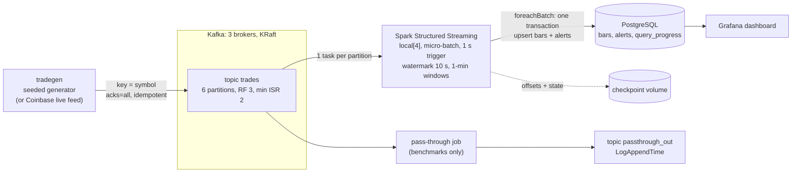

# Architecture and analysis

How Apache Kafka and Spark Structured Streaming work, how they are combined in this project's
market-data pipeline, and which experiment in this repository demonstrates each mechanism. This is
the source for the report's architectural-analysis and functionality sections. References [1] to [5]
are the proposal's; versions are the ones pinned in [decisions.md](decisions.md) (Kafka 4.4.0,
Spark 4.2.1, PostgreSQL 18.6, Grafana 13.3.0).

## 1. The pipeline



Per micro-batch, in order:

```mermaid
sequenceDiagram
  participant D as Spark driver
  participant K as Kafka
  participant C as Checkpoint
  participant P as PostgreSQL
  D->>K: latest offsets per partition
  D->>C: offsets/<n>: planned offset range (write-ahead)
  D->>K: read the range (one task per partition)
  D->>D: aggregate into state; emit windows the watermark has passed
  D->>P: BEGIN; upsert bars; read 31 prior bars; upsert alerts; COMMIT
  D->>C: commits/<n> and state store version n
```

A crash anywhere before `commits/<n>` makes Spark re-run batch *n* from the same offsets after the
restart. Whether that replay is harmless depends only on the sink (section 4).

## 2. Kafka

| Concept | How it works | In this project |
|---|---|---|
| Broker, topic, partition | A topic is split into partitions; each partition is an append-only log on a broker, stored as segment files and written and read sequentially. | `trades` has 6 partitions spread over 3 brokers (`make topics`). |
| Ordering | Kafka orders records only within a partition. The producer picks the partition by hashing the key. | Key = symbol, so each symbol's trades stay in order (every symbol lands in exactly one partition: checked from the ack log in M1). |
| Throughput design [1] | Batching many records per request, sequential disk I/O, the OS page cache, and zero-copy transfer to consumers. | **E1a** reproduces the batching effect (Kreps et al. Fig. 4). |
| Retention | Records are kept for a time or size limit regardless of whether they were read, so any consumer can re-read from any offset. | `trades` keeps 1 day; replay after a crash depends on it. |
| Replication and ISR [2] | Each partition has a leader and followers. Followers that are caught up form the in-sync replica set (ISR). A write is committed when every ISR member has it. | RF 3. `min.insync.replicas=2`: with acks=all a write needs at least 2 copies. `unclean.leader.election.enable=false`: only an in-sync replica can become leader. |
| Producer acks | `acks=0`: no wait. `acks=1`: the leader alone. `acks=all`: every in-sync replica. | **E2** kills the leader of partition 0 with acks=1 and acks=all. |
| Idempotent producer | The broker de-duplicates retried batches by producer id and sequence number, so a retry after a lost acknowledgement does not write twice. | On by default with acks=all here. Found in M1: without it, a leader kill duplicated a trade. E2 measures it (`acks-all-no-idempotence`). |
| KRaft | Cluster metadata lives in a Raft-replicated log on controller nodes; ZooKeeper is gone in Kafka 4. | 3 nodes in combined broker+controller mode, one shared cluster id. |
| Consumer groups | Consumers sharing a `group.id` split a topic's partitions among themselves; a group coordinator assigns partitions, rebalances when members join or leave, and stores each group's committed offsets in the internal `__consumer_offsets` topic. | Used by the verifier and latency collectors (each with its own group). **Spark does not use them** for the pipeline: see section 4. |
| Delivery guarantees | At-most-once (commit before processing), at-least-once (process, then commit; retries may duplicate), exactly-once (idempotent producer plus transactions for read-process-write within Kafka). | End-to-end exactly-once here comes from Spark's replay plus an idempotent sink (section 4), not from Kafka transactions. |
| Security (described, not measured) | TLS encrypts traffic between clients and brokers and between brokers; SASL (for example SCRAM or OAUTHBEARER) authenticates clients; ACLs authorize operations per principal and resource (topic, group, cluster). | Out of scope (PLAN.md 1.3): the stack runs PLAINTEXT on one machine; Grafana and PostgreSQL bind to localhost only. |

## 3. Spark Structured Streaming

| Concept | How it works | In this project |
|---|---|---|
| Model [3] | A stream is an unbounded table; a streaming query is an ordinary DataFrame/SQL query that Spark runs incrementally. | `spark/bars_job.py` is a `groupBy(window, symbol).agg(...)`. |
| Incremental planning | The Catalyst optimizer turns the logical plan into an incremental physical plan: stateful operators (`StateStoreRestore`/`StateStoreSave`) carry partial aggregates between batches. | Visible in the Spark UI (http://localhost:4040, SQL tab). |
| Micro-batch execution and triggers | A trigger starts a batch at fixed intervals; each batch processes the offsets that arrived since the last one. Descended from discretized streams [4]. | Trigger 1 s by default; **E1c** varies it (100 ms, 500 ms, 1 s, 5 s). |
| Continuous processing | Long-running tasks process records one by one; checkpoints happen in epochs. Lower latency, but only map-like operations, at-least-once, and one task (core) per input partition. | Cannot run the bars job. **E1b** runs the pass-through job in both modes. Spike S3: with 6 partitions on 4 cores, two partitions were never processed. |
| Event time, windows, watermark [5] | Windows are defined on the record's event time. The watermark (max event time seen minus a delay) says how late data may arrive; in append mode a window is emitted once, when the watermark passes its end. | 1-minute tumbling windows, watermark 10 s (D6). The generator's closing `__FLUSH__` trade advances the watermark past the last windows. |
| State store | Partial aggregates per (window, key) live in a versioned state store, written to the checkpoint each batch and evicted once the watermark passes. | Open, high, low, close (via `min_by`/`max_by` on (time, trade id)), volume, notional, count. |
| Checkpoint | Directory with `offsets/` (write-ahead: the range each batch will read), `commits/` (batches finished), `state/`, `sources/`, `metadata`. | Named volume `spark-checkpoint`; survives `docker kill` (**E3**, **E4**). |
| Output modes and sinks | Append, update, complete. `foreachBatch` hands each batch to user code; the Kafka sink is at-least-once. | Append + `foreachBatch` into PostgreSQL; the pass-through job uses the Kafka sink. |
| Monitoring | A `StreamingQueryListener` receives a progress event per batch (rows, rates, durations, source offsets). | `spark/progress_listener.py` writes them to `query_progress` (dashboard, throughput tests). |
| ANSI mode (Spark 4 default) | Arithmetic errors raise instead of returning null. | VWAP uses `try_divide`. |

## 4. Integration: how the two systems fit together

* **Partitions become tasks.** The Kafka source plans one Spark task per Kafka partition per batch,
  so partitions bound parallelism (E1c varies 1, 3 and 6 partitions on 4 cores).
* **Offsets live in Spark's checkpoint, not in a consumer group.** Spark decides each batch's offset
  range itself and writes it to `offsets/` *before* processing. That ties offsets atomically to the
  state and to the batch id, which Kafka's committed group offsets cannot do: a group commit says
  "consumed", not "consumed and reflected in state version n and in sink batch n". After a crash
  Spark re-reads exactly the uncommitted range. It requires the topic to retain the data
  (`failOnDataLoss=true` fails loudly if it does not) and the checkpoint to match the topic: the
  harness always wipes both together.
* **Exactly-once output = replay + idempotent sink.** Replay delivers a crashed batch again; the sink
  must make the second write a no-op. Here the batch's bars and alerts are written in one PostgreSQL
  transaction with `INSERT ... ON CONFLICT (symbol, window_start) DO UPDATE`, and `written_at` is set
  on first insert only. **E4** crashes Spark between the database commit and Spark's own commit:
  plain inserts leave duplicate rows, upserts leave none.
* **End to end**, the guarantees compose: an idempotent producer with acks=all (no loss, no
  duplicates into Kafka), replicated logs (survive a broker), checkpointed offsets and state (survive
  Spark), and an idempotent transactional sink (no duplicates out).

## 5. Failure behaviour, with evidence

| Failure | What happens | Measured in |
|---|---|---|
| Leader broker killed, acks=all | Writes to every partition stall until the controller fences the dead broker and removes it from the ISR, then continue; no acknowledged trade is lost. Measured stalls of 9.5 to 11 s match `broker.session.timeout.ms` = 9,000 ms plus up to one 2,000 ms heartbeat interval (checked on the running brokers). | E2 `acks-all` |
| Leader broker killed, acks=1 | Partitions the dead broker led stall until a new leader is elected; records it had acknowledged but not yet replicated are lost when a follower takes over. Not every kill loses data. | E2 `acks-1` (6 kills) |
| Producer retry without idempotence | A retried batch can be written twice. | E2 `acks-all-no-idempotence`; M1 fault check |
| Spark killed | Restart replays from the checkpoint; recovery time is dominated by JVM and Spark start-up. Output stays exact with the upsert sink. | E3 |
| Spark killed after the sink commits, before Spark's commit | The batch is replayed: duplicates with plain insert, none with upsert. | E4 |
| Kafka data lost or topic recreated under a checkpoint | `failOnDataLoss=true` stops the query instead of silently skipping. | Risk R8; harness procedure |

Numbers: [results/RESULTS.md](../results/RESULTS.md) and [results/summary.csv](../results/summary.csv).

## 6. Design choices and their trade-offs

| Choice | Trade-off |
|---|---|
| Watermark 10 s (D6) | Shorter: lower bar latency, more late trades dropped. Longer: the reverse. Bar latency is measured from window end + watermark, so the watermark adds directly to time-to-result. |
| Trigger interval | Shorter: lower latency, more per-batch overhead (E1c). |
| Partitions | More: more parallel tasks, but more state-store and batch-planning overhead on 4 cores (E1c); continuous mode needs a core per partition (E1b). |
| acks=all + min ISR 2 | Durability through one broker failure, at the cost of a write stall while the ISR shrinks (E2). |
| Upsert sink | Exactly-once output; cost measured against plain insert at the same input rate (E4). |
| Alert history read back from PostgreSQL | Keeps the Spark job a plain windowed aggregation (no custom state); costs one indexed query per batch. |
| `local[4]` in one container (D2) | Matches Armbrust et al.'s 4-core setup and the 16 GB budget; no network shuffle; not a test of distributed Spark. |

## References

1. J. Kreps, N. Narkhede, J. Rao. Kafka: a distributed messaging system for log processing. NetDB 2011.
2. G. Wang et al. Building a replicated logging system with Apache Kafka. PVLDB 8(12), 2015.
3. M. Armbrust et al. Structured Streaming: a declarative API for real-time applications in Apache Spark. SIGMOD 2018.
4. M. Zaharia et al. Discretized streams: fault-tolerant streaming computation at scale. SOSP 2013.
5. T. Akidau et al. The Dataflow model. PVLDB 8(12), 2015.
