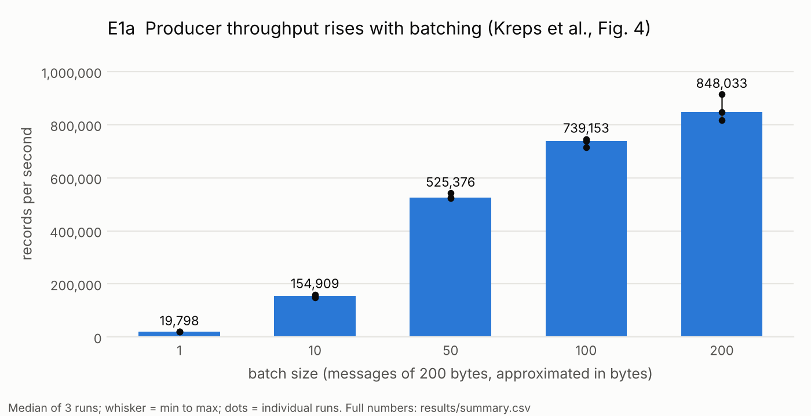
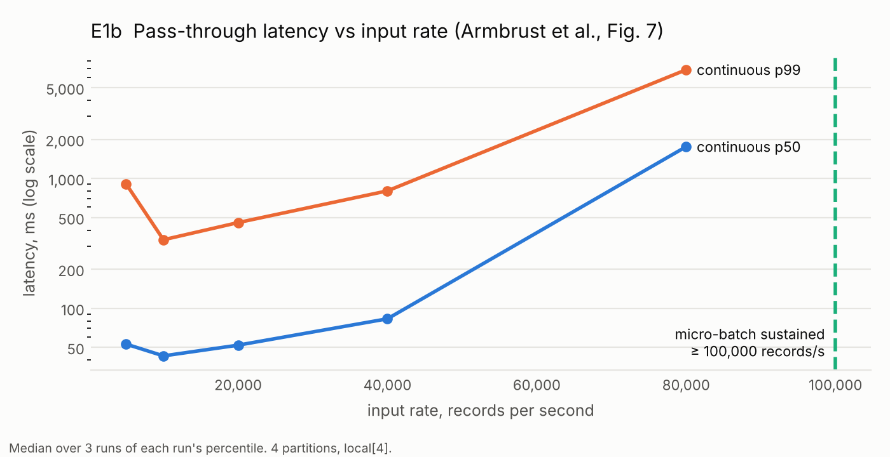
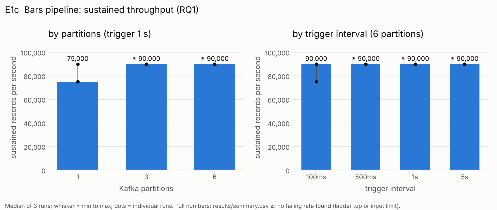
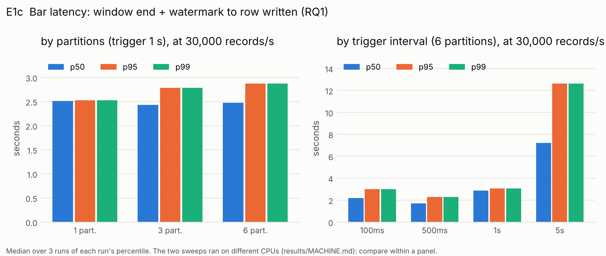
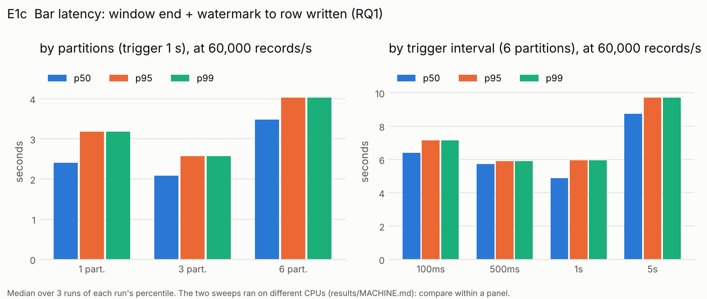
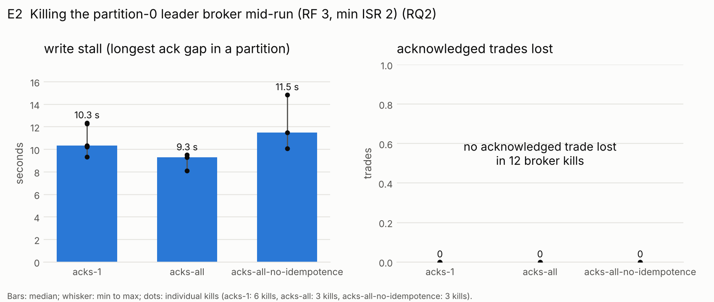
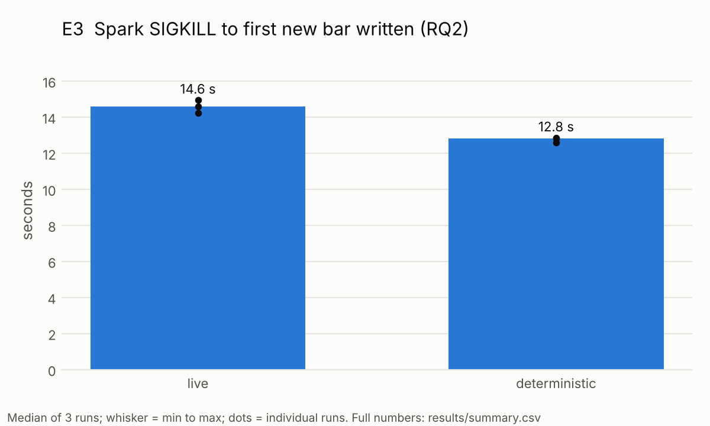
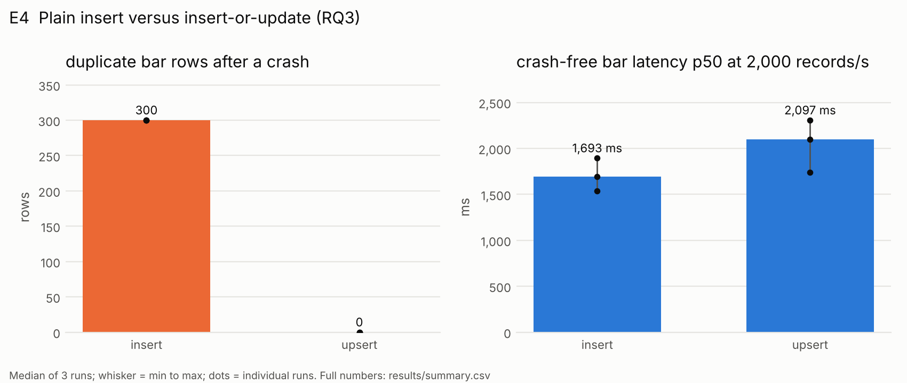

# Results

Generated by `uv run python -m bench.summarize` from `results/raw`. Each cell: median over the runs [min to max], number of runs in brackets after the metric. Machine and versions: [MACHINE.md](MACHINE.md). Every number: [summary.csv](summary.csv).

## E1a Producer batching (reproduction a)

| setting | rate | metric | unit | median | min to max |
|---|---|---|---|---|---|
| batch-1 |  | throughput (3) | records/s | 19,798.373 | 19,524.92 to 19,880.913 |
| batch-1 |  | throughput_mb (3) | MB/s | 3.78 | 3.72 to 3.79 |
| batch-1 |  | latency_p50 (3) | ms | 5,936.0 | 5,883.0 to 5,982.0 |
| batch-1 |  | latency_p99 (3) | ms | 6,945.0 | 6,886.0 to 7,144.0 |
| batch-10 |  | throughput (3) | records/s | 154,909.068 | 147,893.99 to 159,997.44 |
| batch-10 |  | throughput_mb (3) | MB/s | 29.55 | 28.21 to 30.52 |
| batch-10 |  | latency_p50 (3) | ms | 930.0 | 909.0 to 951.0 |
| batch-10 |  | latency_p99 (3) | ms | 1,522.0 | 1,375.0 to 1,884.0 |
| batch-100 |  | throughput (3) | records/s | 739,152.931 | 715,512.307 to 745,934.656 |
| batch-100 |  | throughput_mb (3) | MB/s | 140.98 | 136.47 to 142.28 |
| batch-100 |  | latency_p50 (3) | ms | 12.0 | 4.0 to 37.0 |
| batch-100 |  | latency_p99 (3) | ms | 551.0 | 466.0 to 618.0 |
| batch-200 |  | throughput (3) | records/s | 848,032.564 | 816,526.496 to 914,996.798 |
| batch-200 |  | throughput_mb (3) | MB/s | 161.75 | 155.74 to 174.52 |
| batch-200 |  | latency_p50 (3) | ms | 0.0 | 0.0 to 0.0 |
| batch-200 |  | latency_p99 (3) | ms | 466.0 | 340.0 to 677.0 |
| batch-50 |  | throughput (3) | records/s | 525,375.644 | 522,903.158 to 542,623.04 |
| batch-50 |  | throughput_mb (3) | MB/s | 100.21 | 99.74 to 103.5 |
| batch-50 |  | latency_p50 (3) | ms | 240.0 | 190.0 to 244.0 |
| batch-50 |  | latency_p99 (3) | ms | 687.0 | 674.0 to 846.0 |

## E1b Pass-through, continuous versus micro-batch (reproduction b)

| setting | rate | metric | unit | median | min to max |
|---|---|---|---|---|---|
| continuous-p4 | 5,000 | latency_p50 (3) | ms | 53.0 | 49.0 to 61.0 |
| continuous-p4 | 5,000 | latency_p95 (3) | ms | 378.0 | 376.0 to 456.0 |
| continuous-p4 | 5,000 | latency_p99 (3) | ms | 907.0 | 667.0 to 1,423.0 |
| continuous-p4 | 5,000 | keeps_up (3) | fraction of runs | 1.0 | 1.0 to 1.0 |
| continuous-p4 | 10,000 | latency_p50 (3) | ms | 43.0 | 41.0 to 44.0 |
| continuous-p4 | 10,000 | latency_p95 (3) | ms | 186.0 | 147.0 to 215.0 |
| continuous-p4 | 10,000 | latency_p99 (3) | ms | 337.0 | 224.0 to 466.0 |
| continuous-p4 | 10,000 | keeps_up (3) | fraction of runs | 1.0 | 1.0 to 1.0 |
| continuous-p4 | 20,000 | latency_p50 (3) | ms | 52.0 | 48.0 to 52.0 |
| continuous-p4 | 20,000 | latency_p95 (3) | ms | 248.0 | 213.0 to 254.0 |
| continuous-p4 | 20,000 | latency_p99 (3) | ms | 457.0 | 444.0 to 461.0 |
| continuous-p4 | 20,000 | keeps_up (3) | fraction of runs | 1.0 | 1.0 to 1.0 |
| continuous-p4 | 40,000 | latency_p50 (3) | ms | 83.0 | 76.0 to 91.0 |
| continuous-p4 | 40,000 | latency_p95 (3) | ms | 421.0 | 394.0 to 446.0 |
| continuous-p4 | 40,000 | latency_p99 (3) | ms | 802.0 | 621.0 to 850.0 |
| continuous-p4 | 40,000 | keeps_up (3) | fraction of runs | 1.0 | 1.0 to 1.0 |
| continuous-p4 | 80,000 | latency_p50 (3) | ms | 1,755.0 | 1,551.0 to 2,686.0 |
| continuous-p4 | 80,000 | latency_p95 (3) | ms | 5,799.0 | 3,567.0 to 12,295.0 |
| continuous-p4 | 80,000 | latency_p99 (3) | ms | 6,865.0 | 6,847.0 to 13,195.0 |
| continuous-p4 | 80,000 | keeps_up (3) | fraction of runs | 1.0 | 1.0 to 1.0 |
| microbatch-p4-100ms |  | sustained_throughput (3) | records/s | 100,000.0 | 100,000.0 to 100,000.0 |
| microbatch-p4-100ms |  | sustained_is_lower_bound (3) | fraction of runs | 1.0 | 1.0 to 1.0 |
| microbatch-p4-100ms | 40,000 | latency_p50 (3) | ms | 267.0 | 266.0 to 293.0 |
| microbatch-p4-100ms | 40,000 | latency_p95 (3) | ms | 1,132.0 | 983.0 to 1,189.0 |
| microbatch-p4-100ms | 40,000 | latency_p99 (3) | ms | 1,893.0 | 1,594.0 to 1,915.0 |
| microbatch-p4-100ms | 40,000 | keeps_up (3) | fraction of runs | 1.0 | 1.0 to 1.0 |
| microbatch-p4-100ms | 80,000 | latency_p50 (3) | ms | 449.0 | 398.0 to 481.0 |
| microbatch-p4-100ms | 80,000 | latency_p95 (3) | ms | 1,152.0 | 1,004.0 to 1,427.0 |
| microbatch-p4-100ms | 80,000 | latency_p99 (3) | ms | 1,559.0 | 1,442.0 to 1,953.0 |
| microbatch-p4-100ms | 80,000 | keeps_up (3) | fraction of runs | 1.0 | 1.0 to 1.0 |
| microbatch-p4-100ms | 100,000 | latency_p50 (3) | ms | 619.0 | 504.0 to 674.0 |
| microbatch-p4-100ms | 100,000 | latency_p95 (3) | ms | 1,361.0 | 1,029.0 to 1,370.0 |
| microbatch-p4-100ms | 100,000 | latency_p99 (3) | ms | 1,740.0 | 1,362.0 to 1,763.0 |
| microbatch-p4-100ms | 100,000 | keeps_up (3) | fraction of runs | 1.0 | 1.0 to 1.0 |

## E1c Bars pipeline: partitions and trigger interval (RQ1)

| setting | rate | metric | unit | median | min to max |
|---|---|---|---|---|---|
| p1-1s |  | sustained_throughput (3) | records/s | 75,000.0 | 75,000.0 to 90,000.0 |
| p1-1s |  | sustained_is_lower_bound (3) | fraction of runs | 0.0 | 0.0 to 1.0 |
| p1-1s | 30,000 | latency_p50 (3) | ms | 2,516.232 | 2,078.599 to 2,567.329 |
| p1-1s | 30,000 | latency_p95 (3) | ms | 2,530.076 | 2,493.658 to 2,649.876 |
| p1-1s | 30,000 | latency_p99 (3) | ms | 2,530.213 | 2,493.876 to 2,650.054 |
| p1-1s | 30,000 | keeps_up (3) | fraction of runs | 1.0 | 1.0 to 1.0 |
| p1-1s | 30,000 | batch_duration_p50 (3) | ms | 607.5 | 575.0 to 633.0 |
| p1-1s | 60,000 | latency_p50 (3) | ms | 2,407.596 | 2,399.553 to 2,411.26 |
| p1-1s | 60,000 | latency_p95 (3) | ms | 3,180.715 | 2,750.213 to 3,247.078 |
| p1-1s | 60,000 | latency_p99 (3) | ms | 3,180.873 | 2,751.364 to 3,247.257 |
| p1-1s | 60,000 | keeps_up (3) | fraction of runs | 1.0 | 1.0 to 1.0 |
| p1-1s | 60,000 | batch_duration_p50 (3) | ms | 1,059.5 | 967.5 to 1,111.0 |
| p1-1s | 75,000 | latency_p50 (2) | ms | 11,324.121 | 6,692.216 to 15,956.025 |
| p1-1s | 75,000 | latency_p95 (2) | ms | 16,040.913 | 13,208.737 to 18,873.089 |
| p1-1s | 75,000 | latency_p99 (2) | ms | 16,041.811 | 13,209.838 to 18,873.784 |
| p1-1s | 75,000 | keeps_up (2) | fraction of runs | 1.0 | 1.0 to 1.0 |
| p1-1s | 75,000 | batch_duration_p50 (2) | ms | 5,012.0 | 3,277.0 to 6,747.0 |
| p1-1s | 90,000 | latency_p50 (3) | ms | 38,144.102 | 28,550.254 to 44,130.442 |
| p1-1s | 90,000 | latency_p95 (3) | ms | 41,689.754 | 30,221.512 to 50,780.156 |
| p1-1s | 90,000 | latency_p99 (3) | ms | 41,690.01 | 30,221.649 to 50,780.486 |
| p1-1s | 90,000 | keeps_up (3) | fraction of runs | 0.0 | 0.0 to 1.0 |
| p1-1s | 90,000 | batch_duration_p50 (3) | ms | 12,813.5 | 9,968.0 to 15,849.0 |
| p3-1s |  | sustained_throughput (3) | records/s | 90,000.0 | 90,000.0 to 90,000.0 |
| p3-1s |  | sustained_is_lower_bound (3) | fraction of runs | 1.0 | 1.0 to 1.0 |
| p3-1s | 30,000 | latency_p50 (3) | ms | 2,435.854 | 2,401.316 to 2,646.711 |
| p3-1s | 30,000 | latency_p95 (3) | ms | 2,790.206 | 2,573.778 to 3,230.749 |
| p3-1s | 30,000 | latency_p99 (3) | ms | 2,790.348 | 2,574.234 to 3,231.328 |
| p3-1s | 30,000 | keeps_up (3) | fraction of runs | 1.0 | 1.0 to 1.0 |
| p3-1s | 30,000 | batch_duration_p50 (3) | ms | 612.5 | 532.0 to 651.0 |
| p3-1s | 60,000 | latency_p50 (3) | ms | 2,086.536 | 1,927.022 to 2,884.726 |
| p3-1s | 60,000 | latency_p95 (3) | ms | 2,567.639 | 2,078.889 to 3,992.03 |
| p3-1s | 60,000 | latency_p99 (3) | ms | 2,568.272 | 2,079.95 to 3,992.217 |
| p3-1s | 60,000 | keeps_up (3) | fraction of runs | 1.0 | 1.0 to 1.0 |
| p3-1s | 60,000 | batch_duration_p50 (3) | ms | 911.0 | 875.0 to 975.0 |
| p3-1s | 90,000 | latency_p50 (3) | ms | 3,691.979 | 2,836.68 to 3,741.918 |
| p3-1s | 90,000 | latency_p95 (3) | ms | 4,204.35 | 3,302.445 to 5,768.766 |
| p3-1s | 90,000 | latency_p99 (3) | ms | 4,204.46 | 3,302.555 to 5,768.995 |
| p3-1s | 90,000 | keeps_up (3) | fraction of runs | 1.0 | 1.0 to 1.0 |
| p3-1s | 90,000 | batch_duration_p50 (3) | ms | 1,230.5 | 1,203.0 to 1,460.0 |
| p6-100ms |  | sustained_throughput (3) | records/s | 90,000.0 | 75,000.0 to 90,000.0 |
| p6-100ms |  | sustained_is_lower_bound (3) | fraction of runs | 1.0 | 0.0 to 1.0 |
| p6-100ms | 30,000 | latency_p50 (3) | ms | 2,206.876 | 1,992.225 to 2,359.895 |
| p6-100ms | 30,000 | latency_p95 (3) | ms | 2,990.259 | 2,740.349 to 3,101.142 |
| p6-100ms | 30,000 | latency_p99 (3) | ms | 2,991.113 | 2,740.876 to 3,101.253 |
| p6-100ms | 30,000 | keeps_up (3) | fraction of runs | 1.0 | 1.0 to 1.0 |
| p6-100ms | 30,000 | batch_duration_p50 (3) | ms | 832.0 | 798.0 to 901.5 |
| p6-100ms | 60,000 | latency_p50 (3) | ms | 6,396.893 | 4,983.881 to 7,078.554 |
| p6-100ms | 60,000 | latency_p95 (3) | ms | 7,151.932 | 6,341.203 to 8,328.838 |
| p6-100ms | 60,000 | latency_p99 (3) | ms | 7,152.145 | 6,341.322 to 8,329.087 |
| p6-100ms | 60,000 | keeps_up (3) | fraction of runs | 1.0 | 1.0 to 1.0 |
| p6-100ms | 60,000 | batch_duration_p50 (3) | ms | 2,411.0 | 2,212.5 to 2,630.0 |
| p6-100ms | 75,000 | latency_p50 (1) | ms | 9,588.663 | 9,588.663 to 9,588.663 |
| p6-100ms | 75,000 | latency_p95 (1) | ms | 14,705.787 | 14,705.787 to 14,705.787 |
| p6-100ms | 75,000 | latency_p99 (1) | ms | 14,716.954 | 14,716.954 to 14,716.954 |
| p6-100ms | 75,000 | keeps_up (1) | fraction of runs | 1.0 | 1.0 to 1.0 |
| p6-100ms | 75,000 | batch_duration_p50 (1) | ms | 4,204.0 | 4,204.0 to 4,204.0 |
| p6-100ms | 90,000 | latency_p50 (3) | ms | 39,847.963 | 20,855.289 to 52,874.653 |
| p6-100ms | 90,000 | latency_p95 (3) | ms | 46,284.781 | 24,946.753 to 62,565.227 |
| p6-100ms | 90,000 | latency_p99 (3) | ms | 46,285.436 | 24,946.906 to 62,565.349 |
| p6-100ms | 90,000 | keeps_up (3) | fraction of runs | 1.0 | 0.0 to 1.0 |
| p6-100ms | 90,000 | batch_duration_p50 (3) | ms | 18,470.0 | 8,308.0 to 19,906.0 |
| p6-1s |  | sustained_throughput (3) | records/s | 90,000.0 | 90,000.0 to 90,000.0 |
| p6-1s |  | sustained_is_lower_bound (3) | fraction of runs | 1.0 | 1.0 to 1.0 |
| p6-1s | 30,000 | latency_p50 (3) | ms | 2,476.069 | 2,200.242 to 2,634.415 |
| p6-1s | 30,000 | latency_p95 (3) | ms | 2,874.086 | 2,638.734 to 3,286.391 |
| p6-1s | 30,000 | latency_p99 (3) | ms | 2,874.242 | 2,639.147 to 3,286.621 |
| p6-1s | 30,000 | keeps_up (3) | fraction of runs | 1.0 | 1.0 to 1.0 |
| p6-1s | 30,000 | batch_duration_p50 (3) | ms | 675.0 | 634.0 to 702.0 |
| p6-1s | 60,000 | latency_p50 (3) | ms | 3,480.09 | 2,125.27 to 3,748.934 |
| p6-1s | 60,000 | latency_p95 (3) | ms | 4,026.434 | 2,851.524 to 5,275.064 |
| p6-1s | 60,000 | latency_p99 (3) | ms | 4,026.577 | 2,852.232 to 5,275.197 |
| p6-1s | 60,000 | keeps_up (3) | fraction of runs | 1.0 | 1.0 to 1.0 |
| p6-1s | 60,000 | batch_duration_p50 (3) | ms | 1,312.0 | 1,106.0 to 1,498.5 |
| p6-1s | 90,000 | latency_p50 (3) | ms | 6,339.697 | 3,635.428 to 6,520.544 |
| p6-1s | 90,000 | latency_p95 (3) | ms | 7,244.899 | 6,677.519 to 8,637.369 |
| p6-1s | 90,000 | latency_p99 (3) | ms | 7,245.379 | 6,677.725 to 8,637.553 |
| p6-1s | 90,000 | keeps_up (3) | fraction of runs | 1.0 | 1.0 to 1.0 |
| p6-1s | 90,000 | batch_duration_p50 (3) | ms | 2,636.5 | 2,094.0 to 2,904.0 |
| p6-1s-b |  | sustained_throughput (3) | records/s | 90,000.0 | 90,000.0 to 90,000.0 |
| p6-1s-b |  | sustained_is_lower_bound (3) | fraction of runs | 1.0 | 1.0 to 1.0 |
| p6-1s-b | 30,000 | latency_p50 (3) | ms | 2,867.745 | 2,667.176 to 2,919.088 |
| p6-1s-b | 30,000 | latency_p95 (3) | ms | 3,078.564 | 3,055.488 to 3,520.648 |
| p6-1s-b | 30,000 | latency_p99 (3) | ms | 3,078.735 | 3,055.742 to 3,520.771 |
| p6-1s-b | 30,000 | keeps_up (3) | fraction of runs | 1.0 | 1.0 to 1.0 |
| p6-1s-b | 30,000 | batch_duration_p50 (3) | ms | 858.0 | 804.0 to 911.5 |
| p6-1s-b | 60,000 | latency_p50 (3) | ms | 4,877.546 | 4,529.565 to 6,234.093 |
| p6-1s-b | 60,000 | latency_p95 (3) | ms | 5,939.403 | 5,733.544 to 10,820.656 |
| p6-1s-b | 60,000 | latency_p99 (3) | ms | 5,941.782 | 5,733.848 to 10,822.816 |
| p6-1s-b | 60,000 | keeps_up (3) | fraction of runs | 1.0 | 1.0 to 1.0 |
| p6-1s-b | 60,000 | batch_duration_p50 (3) | ms | 1,967.5 | 1,868.0 to 2,745.0 |
| p6-1s-b | 90,000 | latency_p50 (3) | ms | 19,609.916 | 11,950.387 to 21,901.083 |
| p6-1s-b | 90,000 | latency_p95 (3) | ms | 25,123.576 | 21,780.749 to 28,329.907 |
| p6-1s-b | 90,000 | latency_p99 (3) | ms | 25,124.909 | 21,782.017 to 28,330.474 |
| p6-1s-b | 90,000 | keeps_up (3) | fraction of runs | 1.0 | 1.0 to 1.0 |
| p6-1s-b | 90,000 | batch_duration_p50 (3) | ms | 7,212.0 | 5,620.0 to 9,267.0 |
| p6-500ms |  | sustained_throughput (3) | records/s | 90,000.0 | 90,000.0 to 90,000.0 |
| p6-500ms |  | sustained_is_lower_bound (3) | fraction of runs | 1.0 | 1.0 to 1.0 |
| p6-500ms | 30,000 | latency_p50 (3) | ms | 1,692.635 | 1,656.849 to 1,811.635 |
| p6-500ms | 30,000 | latency_p95 (3) | ms | 2,272.651 | 2,007.675 to 4,224.508 |
| p6-500ms | 30,000 | latency_p99 (3) | ms | 2,272.843 | 2,007.881 to 4,224.77 |
| p6-500ms | 30,000 | keeps_up (3) | fraction of runs | 1.0 | 1.0 to 1.0 |
| p6-500ms | 30,000 | batch_duration_p50 (3) | ms | 680.5 | 623.0 to 747.0 |
| p6-500ms | 60,000 | latency_p50 (3) | ms | 5,721.132 | 4,961.257 to 5,943.52 |
| p6-500ms | 60,000 | latency_p95 (3) | ms | 5,906.4 | 5,098.9 to 6,148.875 |
| p6-500ms | 60,000 | latency_p99 (3) | ms | 5,906.557 | 5,099.072 to 6,149.294 |
| p6-500ms | 60,000 | keeps_up (3) | fraction of runs | 1.0 | 1.0 to 1.0 |
| p6-500ms | 60,000 | batch_duration_p50 (3) | ms | 2,098.0 | 1,905.0 to 2,324.0 |
| p6-500ms | 90,000 | latency_p50 (3) | ms | 21,847.031 | 21,732.823 to 36,526.123 |
| p6-500ms | 90,000 | latency_p95 (3) | ms | 26,955.175 | 23,387.992 to 37,583.265 |
| p6-500ms | 90,000 | latency_p99 (3) | ms | 26,955.352 | 23,388.217 to 37,583.754 |
| p6-500ms | 90,000 | keeps_up (3) | fraction of runs | 1.0 | 1.0 to 1.0 |
| p6-500ms | 90,000 | batch_duration_p50 (3) | ms | 8,187.0 | 7,437.0 to 13,200.0 |
| p6-5s |  | sustained_throughput (3) | records/s | 90,000.0 | 90,000.0 to 90,000.0 |
| p6-5s |  | sustained_is_lower_bound (3) | fraction of runs | 1.0 | 1.0 to 1.0 |
| p6-5s | 30,000 | latency_p50 (3) | ms | 7,205.65 | 6,633.735 to 12,711.177 |
| p6-5s | 30,000 | latency_p95 (3) | ms | 12,623.596 | 8,682.001 to 12,810.713 |
| p6-5s | 30,000 | latency_p99 (3) | ms | 12,623.79 | 8,682.619 to 12,810.924 |
| p6-5s | 30,000 | keeps_up (3) | fraction of runs | 1.0 | 1.0 to 1.0 |
| p6-5s | 30,000 | batch_duration_p50 (3) | ms | 1,987.5 | 1,774.5 to 2,127.5 |
| p6-5s | 60,000 | latency_p50 (3) | ms | 8,741.437 | 8,507.37 to 9,119.45 |
| p6-5s | 60,000 | latency_p95 (3) | ms | 9,708.429 | 9,283.291 to 15,096.957 |
| p6-5s | 60,000 | latency_p99 (3) | ms | 9,708.811 | 9,284.382 to 15,097.732 |
| p6-5s | 60,000 | keeps_up (3) | fraction of runs | 1.0 | 1.0 to 1.0 |
| p6-5s | 60,000 | batch_duration_p50 (3) | ms | 3,773.0 | 3,637.0 to 3,910.5 |
| p6-5s | 90,000 | latency_p50 (3) | ms | 21,318.917 | 18,735.293 to 31,135.043 |
| p6-5s | 90,000 | latency_p95 (3) | ms | 24,594.9 | 23,538.619 to 36,187.718 |
| p6-5s | 90,000 | latency_p99 (3) | ms | 24,595.115 | 23,538.862 to 36,188.068 |
| p6-5s | 90,000 | keeps_up (3) | fraction of runs | 1.0 | 1.0 to 1.0 |
| p6-5s | 90,000 | batch_duration_p50 (3) | ms | 8,587.5 | 7,389.0 to 12,561.0 |

## E2 Broker crash (RQ2)

| setting | rate | metric | unit | median | min to max |
|---|---|---|---|---|---|
| acks-1 |  | lost_trades (6) | trades | 0.0 | 0.0 to 0.0 |
| acks-1 |  | runs_with_loss (6) | fraction of runs | 0.0 | 0.0 to 0.0 |
| acks-1 |  | duplicated_trades (6) | trades | 0.0 | 0.0 to 0.0 |
| acks-1 |  | write_stall (6) | s | 10.338 | 9.347 to 12.35 |
| acks-1 |  | write_stall_all_partitions (6) | s | 0.082 | 0.081 to 0.095 |
| acks-1 |  | bars_correct_vs_generator (6) | fraction of runs | 1.0 | 1.0 to 1.0 |
| acks-1 |  | bars_correct_vs_topic (6) | fraction of runs | 1.0 | 1.0 to 1.0 |
| acks-all |  | lost_trades (3) | trades | 0.0 | 0.0 to 0.0 |
| acks-all |  | runs_with_loss (3) | fraction of runs | 0.0 | 0.0 to 0.0 |
| acks-all |  | duplicated_trades (3) | trades | 0.0 | 0.0 to 0.0 |
| acks-all |  | write_stall (3) | s | 9.3 | 8.114 to 9.509 |
| acks-all |  | write_stall_all_partitions (3) | s | 9.138 | 7.993 to 9.45 |
| acks-all |  | bars_correct_vs_generator (3) | fraction of runs | 1.0 | 1.0 to 1.0 |
| acks-all |  | bars_correct_vs_topic (3) | fraction of runs | 1.0 | 1.0 to 1.0 |
| acks-all-no-idempotence |  | lost_trades (3) | trades | 0.0 | 0.0 to 0.0 |
| acks-all-no-idempotence |  | runs_with_loss (3) | fraction of runs | 0.0 | 0.0 to 0.0 |
| acks-all-no-idempotence |  | duplicated_trades (3) | trades | 0.0 | 0.0 to 0.0 |
| acks-all-no-idempotence |  | write_stall (3) | s | 11.51 | 10.098 to 14.847 |
| acks-all-no-idempotence |  | write_stall_all_partitions (3) | s | 9.424 | 8.403 to 11.025 |
| acks-all-no-idempotence |  | bars_correct_vs_generator (3) | fraction of runs | 1.0 | 0.0 to 1.0 |
| acks-all-no-idempotence |  | bars_correct_vs_topic (3) | fraction of runs | 1.0 | 0.0 to 1.0 |

## E3 Spark crash (RQ2)

| setting | rate | metric | unit | median | min to max |
|---|---|---|---|---|---|
| deterministic |  | kill_to_first_batch (3) | s | 13.081 | 12.815 to 13.939 |
| deterministic |  | kill_to_first_bar (3) | s | 12.813 | 12.589 to 12.85 |
| deterministic |  | restart_to_first_batch (3) | s | 12.816 | 12.579 to 13.68 |
| deterministic |  | output_correct (3) | fraction of runs | 1.0 | 1.0 to 1.0 |
| live |  | kill_to_first_batch (3) | s | 13.726 | 13.394 to 14.383 |
| live |  | kill_to_first_bar (3) | s | 14.601 | 14.243 to 14.942 |
| live |  | restart_to_first_batch (3) | s | 13.442 | 13.134 to 14.114 |
| live |  | output_correct (3) | fraction of runs | 1.0 | 1.0 to 1.0 |

## E4 Exactly-once cost (RQ3)

| setting | rate | metric | unit | median | min to max |
|---|---|---|---|---|---|
| insert-cost | 2,000 | bar_latency_p50 (3) | ms | 1,693.481 | 1,535.287 to 1,893.89 |
| insert-cost | 2,000 | bar_latency_p95 (3) | ms | 2,450.319 | 2,340.51 to 2,497.741 |
| insert-cost | 2,000 | bar_latency_p99 (3) | ms | 2,450.419 | 2,340.806 to 2,498.035 |
| insert-cost | 2,000 | batch_duration_p50 (3) | ms | 460.0 | 420.0 to 483.0 |
| insert-cost | 2,000 | keeps_up (3) | fraction of runs | 1.0 | 1.0 to 1.0 |
| insert-crash |  | duplicate_bar_rows (3) | rows | 300.0 | 300.0 to 300.0 |
| insert-crash |  | duplicate_alert_rows (3) | rows | 0.0 | 0.0 to 0.0 |
| insert-crash |  | output_correct (3) | fraction of runs | 0.0 | 0.0 to 0.0 |
| upsert-cost | 2,000 | bar_latency_p50 (3) | ms | 2,096.582 | 1,737.884 to 2,306.305 |
| upsert-cost | 2,000 | bar_latency_p95 (3) | ms | 2,427.313 | 2,360.974 to 2,598.693 |
| upsert-cost | 2,000 | bar_latency_p99 (3) | ms | 2,427.601 | 2,362.625 to 2,599.553 |
| upsert-cost | 2,000 | batch_duration_p50 (3) | ms | 451.0 | 418.5 to 490.5 |
| upsert-cost | 2,000 | keeps_up (3) | fraction of runs | 1.0 | 1.0 to 1.0 |
| upsert-crash |  | duplicate_bar_rows (3) | rows | 0.0 | 0.0 to 0.0 |
| upsert-crash |  | duplicate_alert_rows (3) | rows | 0.0 | 0.0 to 0.0 |
| upsert-crash |  | output_correct (3) | fraction of runs | 1.0 | 1.0 to 1.0 |

## Figures

